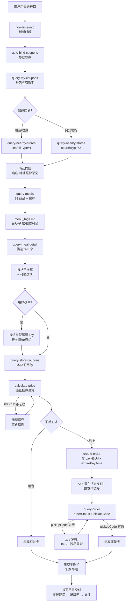

# MCP_INTEGRATION.md — mcspeak 与麦当劳 MCP 的集成说明

> 全部结论来自 2026-10-24 对门店 `3350020`（麦当劳济南山大路(成大高科)餐厅）的实测，原始返回见 `references/samples/`。
> 工具级别手册见 `references/mcd_tools.md`。

---

## 1. 用到的工具（13 个）

| 分组 | 工具 | 在 mcspeak 里做什么 | 业务价值 |
|---|---|---|---|
| **门店** | `now-time-info` | 判断早餐/正餐/夜宵时段，推导预约时间 | 所有时间判断的唯一可信源，避免访客手机时区错误 |
| | `query-nearby-stores` | 按地标搜门店（`searchType=2`）/ 取收藏门店（`searchType=1`） | 让"我在山大附近"变成具体门店；同时拿到店名与地址原文 |
| **菜单** | `query-meals` | 拉 14 分类 / 93 个商品，含现价与原价 | 推荐的事实基础；价格用于"线上 vs 柜台"两套报价 |
| | `query-meal-detail` | 拿套餐轮次（`rounds`）+ 可定制项（`modification`） | **能真正改单**的关键：拿到 `selectedKey`/`unselectedKey` 才能去生菜、去冰 |
| | `list-nutrition-foods` | 按名称匹配热量（仅 18/93 命中） | 给"想吃 500 大卡"的人一个参考；匹配不到就如实说没有 |
| **券** | `available-coupons` | 看还能领哪些券 | 领券前的清单，提示"有 0 元券" |
| | `auto-bind-coupons` | 静默一键领券 | 帮游客把能领的券先领掉，不用他懂"麦麦省" |
| | `query-my-coupons` | 券包与有效期（无 couponId/couponCode） | 解释"为什么今天用不了、几号能用" |
| | `query-store-coupons` | 本店 + 本订单类型**可用**的券 | 唯一可信的可用性判断；空数组 ≠ 没券 |
| **计价与订单** | `calculate-price` | 核价 + 拿 `takeWayList` | 下单前必调；也是唯一的口径来源（分） |
| | `create-order` | 下单，拿 `payH5Url` / `expirePayTime` | 线上点餐入口；支付链接**只在这里出现** |
| | `query-order` | 查状态、查取餐码 | 付款确认、等餐、取餐卡全靠它 |
| | `cancel-order` | 制作前取消（`cancelReasonCode`） | 游客改主意时的兜底 |
| **历史** | `order-list` | 读历史订单名称 | 支持"和上次一样"，且只读不展示订单号/金额 |

> 明确**不使用**：`mall-create-order`、`party-order-create`、`draw-lottery`（积分商城 / 派对 / 抽奖不在本 Skill 范围）。

---

## 2. 调用流程图



---

## 3. 每个工具的业务价值（展开）

### 3.1 `query-nearby-stores` —— 把"我在哪"变成"这家店"

游客只会说"山东大学附近"。`searchType=2`（city + keyword）能把地标转成 5 家门店并给出 `distance`，我们取最近的 3 家，配上中文店名 + 拼音，让他**对照店门口招牌**确认。

> 收藏门店（`searchType=1`）只用来显示店名——它没有营业时间、`distance` 恒为 0。

### 3.2 `query-meal-detail` —— 唯一的"可改"依据

这是整套能力里最值钱的接口。它返回三层：`rounds`（套餐轮次）→ `choices`（可选商品）→ `modification`（可去配料）。没有它就不知道"这个汉堡能不能去生菜""可乐能不能去冰"，也就只能做翻译。

### 3.3 `calculate-price` —— 报价的唯一口径

返回**分**（`3350`），并且带 `takeWayList`（堂食 `eat-in` / 外带 `take-in-store`）。下单时 `takeWayCode` 只能从这里取。

### 3.4 `create-order` / `query-order` —— 支付与取餐的分界线

- `create-order` 是**唯一**返回 `payH5Url` 的地方，也是 `expirePayTime`（约 +15 分钟）的来源。
- `pickupCode` 在付款前是**空字符串**，付款成功后才有值（实测 5 位数字，样本已脱敏为 `00000`）。
- 所以卡片必须分两个阶段：**付款前只有待付款卡，付款后才能出取餐卡**。

### 3.5 `query-store-coupons` —— 券的可用性闸门

券挂在 `items[i].couponId + couponCode` 上，服务端**逐券强校验**。先查这里，能少踩一次整单失败。

---

## 4. 实测踩坑（都会导致线上事故）

### 坑 1｜`modification` 的 key 必须**按组类型**解释

| 组类型 | 判定 | key 语义 | 传法 |
|---|---|---|---|
| **开关组** | `values[]` 里**有 `unselectedKey`** | `selectedKey`=保留、`unselectedKey`=去掉 | 组内**所有项都必须传** |
| **单选组** | 无 `unselectedKey` 且 `minValues=1 && maxValues=1` | 每个 key 就是**一个选项**，按名称匹配 | 只传选中的那一个 |

实测冰量（`code` 恒为 `200002`，4 个选项 code 相同）：

| 选项 | key |
|---|---|
| 标准 | `0-1` |
| **去冰** | **`0-0`** |
| 多冰 | `0-2` |
| 少冰 | `1-1` |

> ⚠️ **同一个 `0-0` 在两类组里含义相反**：开关组里是"去掉"，单选组（冰量）里是"去冰"这个选项。不能写全局 key→含义映射。

订单回显可用来核对：`麦辣鸡腿汉堡 切块生菜(不要)`、`可乐中杯 冰(去冰)`。

### 坑 2｜券必须**逐张试算**，失败就摘掉

一张无效券会让**整个** `calculate-price` 失败：

```json
{"success": false, "code": 600012, "message": "此卡券不在使用日期内，请在有效期内来使用哦！"}
```

不会自动降级成"无券价"。所以：`query-store-coupons` → 匹配到具体商品行 → 试算 → 失败摘券重算 → 取实付最低。

### 坑 3｜金额单位两套

| 接口 | 单位 | 示例 |
|---|---|---|
| `query-meals` | **元字符串** | `"33.5"` |
| `calculate-price` | **分整数** | `3350` |
| `create-order` / `query-order` | **元字符串** | `"33.5"` |

同一个 ¥33.50 有 3 种写法，不归一化就会显示成 ¥0.34 或 ¥3350。

### 坑 4｜状态码以**实测**为准，文档不可信

工具文档写 `1待支付、2配餐中、4配送中、6已完成、7已取消、8已评价、10配餐中`。
实测：**`10` = 待支付、`40` = 订单已完成、`60` = 订单已取消**。

**主链路五态**（真实付款一单后按 App 顺序记录）：

```
待支付 → 确认中 → 配餐中 → 待取餐 → 订单已准备完毕
```

其中 `确认中 / 配餐中 / 待取餐 / 订单已准备完毕` 的**数字码未逐个取到**，所以判断一律用 **文字**（`orderStatus`）做主键，码只做辅助：

```js
const byText = {
  '待支付':'10', '确认中':null, '配餐中':null,
  '待取餐':null, '订单已准备完毕':null,      // ★ 这两个都可以去取餐
  '订单已完成':'40', '订单已取消':'60',
};
// 未收录的状态 → 只意译，不猜
```

### 坑 4b｜`pickupCode` 在 App 上叫「订单号」

接口字段 `pickupCode`（取餐号）在麦当劳 App 订单页显示为「**订单号**」；
而接口另有 `orderId`，卡片**不展示**。App 里的「订单编码」是长串编号，**不是取餐号**。
→ 卡片必须写一句「App 里这一行叫订单号」，否则访客会拿长编码去柜台。

### 坑 5｜超时不是"已过期"，是"订单已取消"

超过 `expirePayTime` 未付款，`orderStatus` 直接变「订单已取消」`status=60`，**没有"已过期"这个状态**。
而且超时后 `totalAmount` **不归零**、`payId` 仍在 → **只能靠 `orderStatus` 判断订单是否有效**。

### 其他细节坑

| 坑 | 应对 |
|---|---|
| 经纬度恒 `0.0` | 地图卡用"店名+城市"搜索链接，不显示坐标 |
| 菜单 99 条目 / 93 商品 | 按 `code` 去重 |
| `productCode` 是字符串（4/6/10 位混排） | 不转 int |
| `list-nutrition-foods` 的 `data` 是多行 CSV 字符串 | 按行 split，无 `productCode`，只能按名称匹配（18/93） |
| 特调全是 0 元 | 价格看不出是否生效 → 用订单 `comboItemList` 核对 |
| `reservationDate: null` | 触发 schema 校验失败，非预约场景干脆不传 |
| 订单里会混入非餐品行 | 如「麦金卡月卡（30天）」，卡片上不列 |

---

## 5. 一次真实调用的形状（脱敏）

```jsonc
// create-order（节选）
{
  "data": {
    "orderId": "1030000000000000000000000001",     // 已脱敏
    "payId": "1110000000000000000001",             // 已脱敏
    "payH5Url": "https://example.invalid/pay?orderId=REDACTED",
    "orderDetail": {
      "orderStatus": "待支付", "status": "10",
      "pickupCode": "00000",                            // 付款前为空
      "expirePayTime": "2026-10-24 19:13:45",      // createTime + 15min
      "takeWay": "外带",
      "orderProductList": [{
        "productName": "麦辣鸡腿汉堡三件套", "quantity": 1, "price": "33.5",
        "comboItemList": [
          { "itemName": "麦辣鸡腿汉堡 切块生菜(不要)", "itemQuantity": 1 },
          { "itemName": "中薯条", "itemQuantity": 1 },
          { "itemName": "可乐中杯 冰(去冰)", "itemQuantity": 1 }
        ]
      }]
    }
  }
}
```
